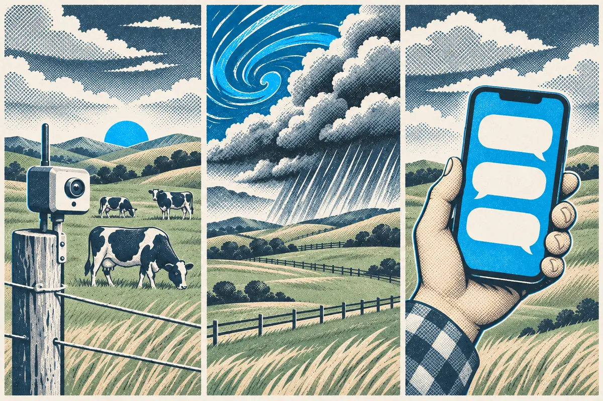

# AI in plain English

"AI" gets stuck on everything from ear tags to tractors. Under the label there are three kinds of tool, and once you can tell them apart, the claims get easier to judge.

<video controls poster="/api/content/farm-ai-commons/@modules/fac-01-what-ai-is/assets/fac-l1-poster.jpg" playsinline preload="metadata" aria-label="Lesson 1 video: AI in plain English" style="width: 100%; max-width: 800px; border-radius: 12px; margin: 1.5rem auto; display: block;">
  <source src="./assets/fac-l1.mp4" type="video/mp4">
  <track kind="captions" src="./assets/fac-l1.vtt" srclang="en-NZ" label="English (NZ)">
  Your browser cannot play this video.
</video>

> **On the farm:** You've probably used all three kinds already this year without calling any of them AI. A collar that flags a cow on heat, a forecast app that says rain Thursday, and a phone that turns your voice into a text message.

## Learning outcomes

By the end of this lesson, you will be able to:

- Name the three kinds of AI: AI that senses, AI that predicts, and AI that writes and talks.
- Put a farm tool into the right kind.
- Explain in one sentence how a chat AI comes up with its answers.

## Three kinds of AI

### 1. AI that senses

It takes in readings from the world and spots a pattern. A collar notices a cow is chewing her cud less than usual. A camera on a sprayer tells a weed from a crop. A crush scale reads a tag and matches a weight to the right animal.

### 2. AI that predicts

It learns from years of past numbers and makes a call about what comes next. Pasture growth models, weather forecasts and lambing date estimates all work this way. The output is a best guess with some spread either side, never a promise.

### 3. AI that writes and talks

These are the chat tools: ChatGPT, Gemini, Claude, Copilot, Amazon Quick and others. You type or say a question in normal words, and it writes back in normal words. This is the kind most people mean when they say "AI" now, and it's the kind this course spends most of its time on.

:::widget fac-sort-the-ai
title: Sort the AI
description: One farm tool at a time: tap the kind of AI it is, Senses, Predicts, or Writes and talks.
:::

## How a chat AI comes up with an answer

A chat AI has read a huge amount of text: websites, books, manuals, forum posts. From all that reading it learned which words tend to follow which.

When you ask it something, it writes the answer one small piece at a time, each time picking a likely next word. Try finishing this sentence in your head:

> After weaning, we moved the ewes back onto the ...

You probably thought "hill" or "back block", not "beach". A chat AI does the same thing, very fast, millions of times over.

That one idea explains most of what it does well and most of what it gets wrong:

- **Good:** it's read so much that its likely words are often useful. It writes clear text and explains things in plain language.
- **Wrong:** a likely-sounding answer isn't always a true one. When it doesn't know, it still writes something that sounds right.

Some apps can also search the web or read a file you give them. That helps, because the answer can then draw on what it found. It still writes the answer by picking likely words, so the checking habit stays the same.

## Try it

Think of one tool on your farm, or one you've seen at a field day, that gets called AI. Which of the three kinds is it, and what does it sense, predict or write?

Our pasture app gives a cover reading for each paddock from satellite photos. That's AI that predicts: it has learned how the colour of a paddock from above lines up with plate meter readings, and it makes a best guess for our paddocks. It isn't measuring the grass directly, so I'd still walk the paddocks before a big feed decision.

## Key takeaways

- AI comes in three kinds: it senses, it predicts, or it writes and talks.
- Chat tools like ChatGPT, Gemini, Claude, Copilot and Amazon Quick are the "writes and talks" kind.
- A chat AI picks likely words, one after another, based on what it has read.
- Likely isn't the same as true, so a confident answer still needs checking.

Next, you'll see where these tools are already turning up on New Zealand farms.
