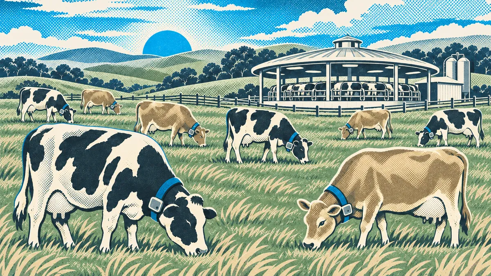
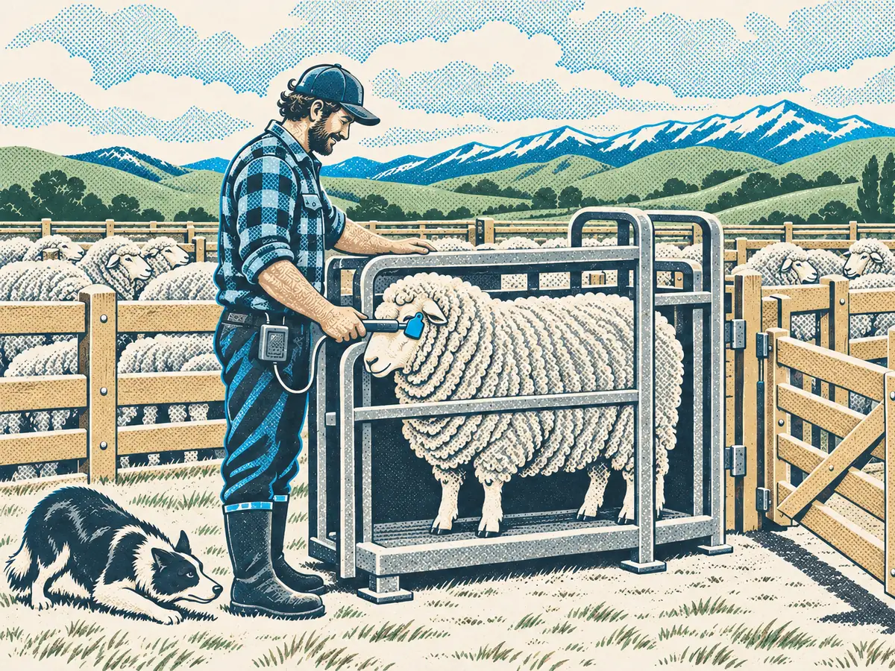
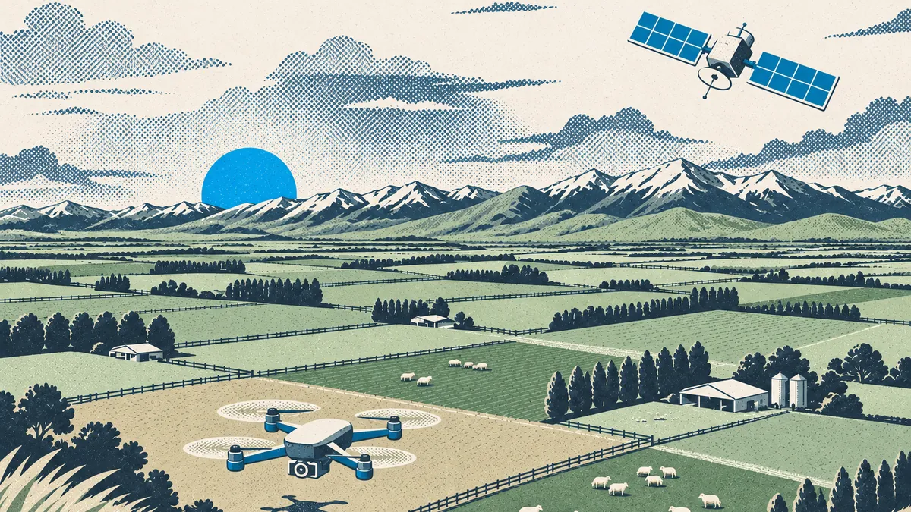
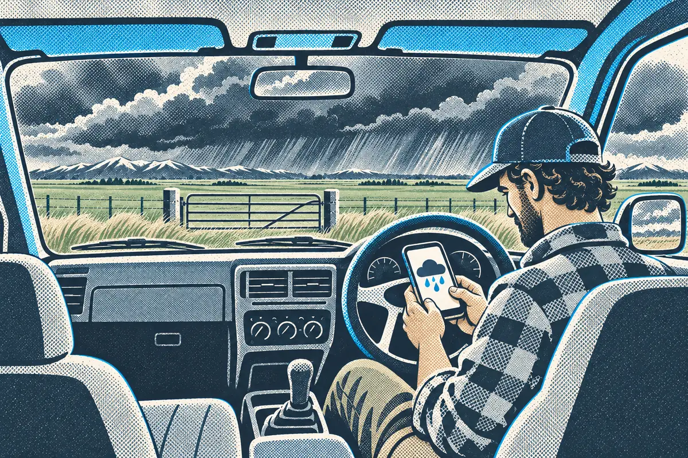

# AI already on your farm

Most farmers who say they've never used AI already have. It's in the collar, the crush scale, the pasture app and the forecast. What changed after 2023 is the third kind: AI you can talk to.

<video controls poster="/api/content/farm-ai-commons/@modules/fac-01-what-ai-is/assets/fac-l2-poster.jpg" playsinline preload="metadata" aria-label="Lesson 2 video: AI already on your farm" style="width: 100%; max-width: 800px; border-radius: 12px; margin: 1.5rem auto; display: block;">
  <source src="./assets/fac-l2.mp4" type="video/mp4">
  <track kind="captions" src="./assets/fac-l2.vtt" srclang="en-NZ" label="English (NZ)">
  Your browser cannot play this video.
</video>

> **On the farm:** Knowing which tools on your farm already use AI helps you ask better questions when a rep says "it's got AI in it". What does it sense or predict, from what data, and how often is it wrong?

## Learning outcomes

By the end of this lesson, you will be able to:

- Name four places AI already turns up on New Zealand sheep, beef and dairy farms.
- Say what each one senses or predicts.
- Describe what's new since 2023: AI that writes, reads documents and does jobs for you.

## Collars and virtual fencing

Virtual fencing collars move stock with sound, vibration or a mild pulse instead of wire. The fence lines are drawn on a phone. Many collars also record movement and chewing time, and the software learns what's normal for each animal. When a cow's pattern changes, it flags her: she may be on heat, or getting sick.

That's AI that **senses**. It doesn't know the cow, only that her pattern looks different from usual.

## EID weighing and drafting

An EID reader in the race reads the tag, the scale records the weight, and the drafting gate sorts by weight or by a list. A lot of this is straight automation, and that's fine. The AI part comes when software uses the weight records to predict, for example which lambs will reach a target weight by a date, or which animals are falling behind their mob.

## Pasture sensing

Satellite pasture tools estimate cover for each paddock from photos taken from space. They learned by matching what paddocks look like from above against thousands of plate meter and cut readings on the ground. That's AI that **predicts**, and like any estimate it can be off, especially under cloud, on steep country or after a big change in the paddock.

## Weather forecasts

Forecasts have long come from big physics models run on supercomputers. Some major forecasting centres now also run AI weather models, trained on decades of past weather, alongside the traditional ones. Either way the forecast in your app is a prediction with a range around it.

## What's new since 2023

The first two kinds, sensing and predicting, have been creeping onto farms for years. The big change since 2023 is AI that **writes and talks**:

- **It writes.** Ask for a text to your shearer, a summary of a long email or a plain-words explanation of a regulation, and you get a draft in seconds.
- **It reads documents.** Many tools can now read a PDF, a photo of a page or a spreadsheet you give them, and answer questions about it.
- **It does jobs for you.** Newer tools can take a few steps on their own, such as looking something up, filling in a table and drafting a message, before handing it back to you to check. You'll build some of these in later modules.

## Try it

List the tools on your farm that might use AI. For one of them, what does it sense or predict, and how would you know if it got it wrong?

Our collars, our weather app and the cover readings from the pasture app. The collars flag cows that look off. I'd know they got it wrong if a flagged cow is fine when I check her, or a cow goes lame and wasn't flagged. I keep a note of both so I can see how often it's right.

## Key takeaways

- Collars, EID systems, pasture tools and forecasts can all use AI that senses or predicts.
- Some of what gets called AI is plain automation. That's fine, but it's worth knowing which is which.
- What's new since 2023 is AI that writes, reads documents and does small jobs for you.
- Every one of them can be wrong, so keep your own eyes on the stock and the paddocks.

Next: what chat AI is good at, and where it trips up.
