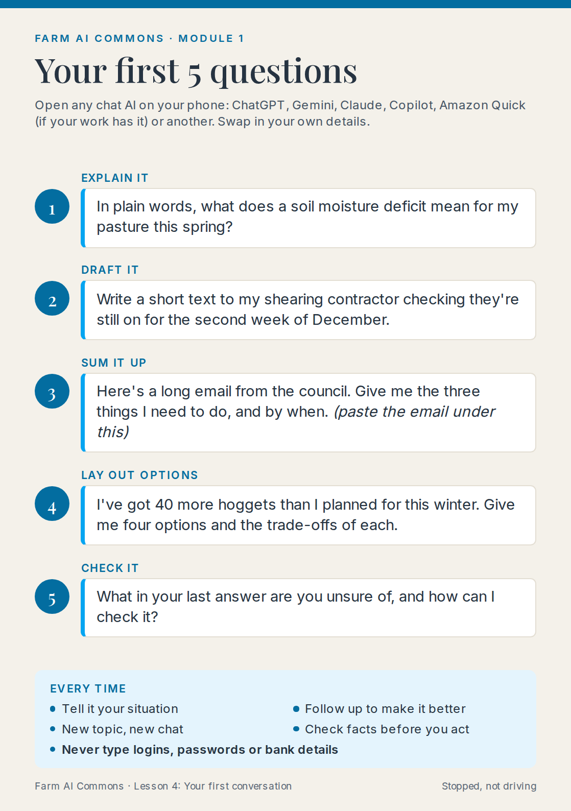

# Your first conversation

You don't need a computer or any special words. A phone and a question about something you're dealing with this week is enough.

<video controls poster="/api/content/farm-ai-commons/@modules/fac-01-what-ai-is/assets/fac-l4-poster.jpg" playsinline preload="metadata" aria-label="Lesson 4 video: Your first conversation" style="width: 100%; max-width: 800px; border-radius: 12px; margin: 1.5rem auto; display: block;">
  <source src="./assets/fac-l4.mp4" type="video/mp4">
  <track kind="captions" src="./assets/fac-l4.vtt" srclang="en-NZ" label="English (NZ)" default>
  Your browser cannot play this video.
</video>

> **On the farm:** A good first question is a real one. Something you'd normally ring a mate about, look up at night, or put off because the paperwork is a pain.

## Learning outcomes

By the end of this lesson, you will be able to:

- Open a chat AI on your phone and ask it a question by typing or speaking.
- Follow up to get a better answer.
- Start a fresh chat when you change topic.
- Use voice hands-free in the ute, safely.

## 1. Open an app

Pick any of the main chat apps: ChatGPT, Gemini, Claude or Copilot, or Amazon Quick if your work or business has it. They all work much the same way. Download the app from your phone's app store, or open its website in your phone's browser. Most will ask you to sign in with an email address or an existing Google, Apple or Microsoft account. For Amazon Quick, sign in with the account your work or business gave you.

> **Hint:** If someone in the house already uses one, start with that. It's easier to learn with someone who can show you where things are.

## 2. Type or speak your question

At the bottom of the screen there's a box that says something like "Ask anything" or "Message". Tap it and type your question, or tap the microphone and say it.

Write it the way you'd say it to a person. Add the details that matter:

> I run 2,000 ewes on hill country near Kurow. Shearing is booked for the second week of December. Write a short text to my shearing contractor checking they're still on for that week.

The more of your situation you give it, the less it has to guess.

## 3. Follow up

The first answer is a starting point. Reply in the same chat, like a text conversation:

> Make it shorter and less formal.

> Add that the woolshed power is fixed now.

It remembers what you've said earlier in the same chat, so you don't need to repeat yourself.

## 4. Start a fresh chat for a new topic

When you move on to something different, start a new chat. Look for a **+** or a pencil icon, usually at the top of the screen.

Everything earlier in a chat shapes the next answer. If you've been talking about shearing and then ask about calf rearing, bits of the shearing chat can creep in. A fresh chat gives a clean start.

## 5. Use voice in the ute

Most of the main apps have a voice mode. You talk, it talks back, and you can keep going without touching the screen. It's handy for thinking a problem through on the way to the yards.

> **Warning:** Set it up before you drive. Start the voice chat while you're stopped, put the phone in a cradle, and don't hold it while driving. If an answer needs reading, typing or checking, pull over first.

## Your first 5 questions

Keep these on the fridge or in the ute. Each one is a different kind of job chat AI is good at, and the last one is the habit that keeps you safe.

[Download the card as a printable PDF](./assets/fac-first-5-questions.pdf)

> **Important:** Don't type logins, passwords, bank details or other people's personal information into a chat AI. Module 2 covers what's safe to share and where your words go.

## Try it

Open a chat app now and ask one of the five questions, using a real job from your week.

What did you ask, what did you follow up with, and was the second answer better than the first?

**Model response:** I asked it to write a text to the shearer about the second week of December. The first version was too long and too polite. I followed up with "shorter, and say the woolshed power is fixed", and the second one was close to what I'd write myself. I changed one word and sent it.

## Key takeaways

- Any of the main chat apps will do. Open one, then type or speak your question.
- Give it the details of your situation, then follow up to improve the answer.
- Start a fresh chat when you change topic.
- Set up voice before you drive, and pull over for anything you need to read.

Next is the build: you'll ask AI about rain on your own farm, first with no data and then with the real gauge numbers.
