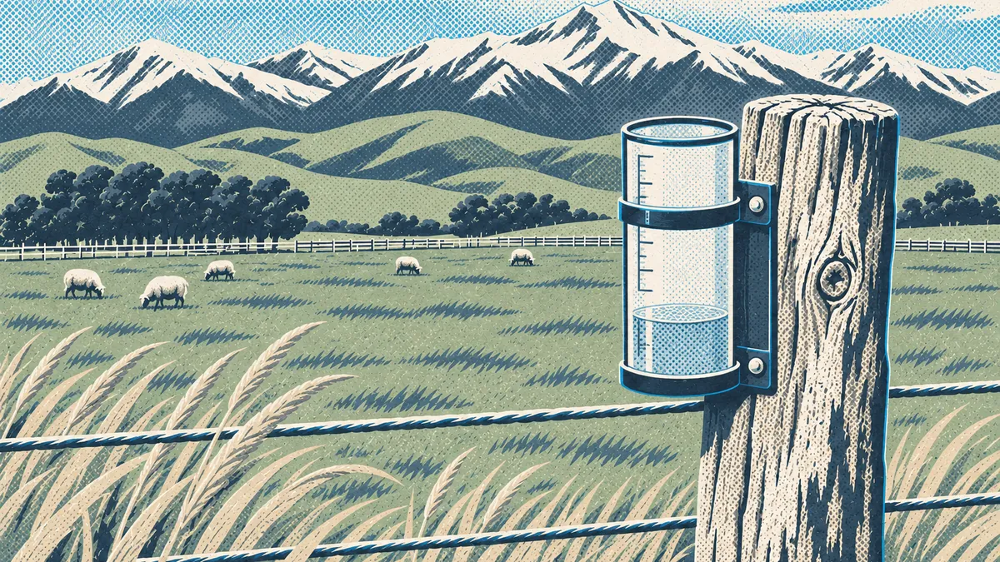

# Build: Ask about your farm

Time to ask AI about your own place. You'll ask it about this season's rain twice: once with nothing to go on, and once with real numbers for your area. Then you'll compare the two answers.

> **On the farm:** Rain since 1 July sets up your spring: grass growth, when to sell, whether to buy in feed. It's a question every farmer has an answer to, so you'll know straight away if AI is guessing.

## What you'll need

- A chat AI app on your phone or computer (any of them, see the last lesson)
- Your farm's address
- About 30 minutes

## Step 1: Find your farm

Type your farm's address into the rain card below. The Farm AI Commons looks it up in the national address and parcel maps from LINZ and puts your farm on the map.

> **Good to know:** An address finds one parcel, and that's often the house block. Your farm may span several titles. For rain that doesn't matter much, because the nearest gauge and the climate grid cover the whole area. Later modules use your full farm boundary.

## Step 2: Ask AI cold

Before you look at your card, open your chat AI, start a fresh chat and ask this, with your district in place of Kurow:

> How much rain has the Kurow district had since 1 July, and is that normal?

Don't attach anything and don't add any figures. Write down or screenshot what it says. Note any numbers it gives and how sure it sounds.

What did AI say with no data? Write down any rain figures it gave and whether it said the season was wet, dry or normal.

**Example:** "It said about 180 mm since July, which it called a bit dry for the Waitaki. It didn't say where the figure came from."

## Step 3: Open your rain card

:::widget fac-rain-card
title: Rain card
description: Type your farm address to see rain since 1 July for your area, compared with normal, as a card you can copy into any AI.
:::

Your card shows:

- **Your nearest open council rain gauge** (Canterbury and North Otago for now), and how far it is from your address.
- **Rain at that gauge since 1 July**, with a total for each month.
- **How this season compares with normal**, from the ERA5 climate record for the nearest ~25 km climate grid cell. It compares this season in that cell with the 1991 to 2020 average for the same dates in the same cell, as a percentage.
- **Where every number came from** (tap **Sources and notes**), and the date the card was made.

> **Note:** A gauge measures the rain that falls in one spot. A climate grid cell averages about 25 km by 25 km, so it can read quite a bit wetter or drier than any one gauge. That's why the card compares the cell with its own long-term average, and shows the gauge total separately, rather than putting one against the other.

If the live data won't load, open **No signal? Use saved figures for a district** under the address box (it opens by itself if the live figures fail). It shows figures saved for the field-day districts, and says the date they were saved.

## Step 4: Ask again with the card

Same question, now with the real numbers. There are two ways to do it.

### Way 1: Paste the card (works in any app)

1. Tap **Copy card** on the rain card.
2. Go back to your chat AI and start a fresh chat.
3. Paste the card into the message box. Under it, type the same question:

> How much rain has my district had since 1 July, and is that normal? Use the rain card above, and say which numbers you used.

### Way 2: Connect the Farm AI Commons connector (optional)

Some AI apps let you add a connector, so the app can fetch the rain data itself when you ask. The Farm AI Commons connector is public and read-only. It has no accounts, and it only returns public data about the address you give it.

Connector address:

> https://farm-ai-commons-api.mail-5bc.workers.dev/mcp

- **Claude** (any plan, including free, which allows one custom connector): on claude.ai in a web browser, open Settings, find **Connectors** and choose **Add custom connector**. Name it Farm AI Commons and paste the connector address. Once it's added, it also works in the Claude phone app. Ask your question and include your address.
- **ChatGPT** (paid plans only, on the website, still in beta): open Settings, then **Apps & Connectors**, then **Advanced**, and turn on **Developer mode**. Then create a connector with the connector address. On some plans the tools don't show up yet. If that happens, use Way 1.
- **Amazon Quick** (Enterprise plan only, and an administrator adds it): in Amazon Quick, open **Connectors**, choose the **Create for your team** tab, then **Model Context Protocol (MCP)**. Name it Farm AI Commons, paste the connector address as the MCP server endpoint, choose **Public network** and no authentication, then share it with the people who need it. If the tools don't show up, use Way 1.
- **Gemini, Copilot and others:** so far, custom connectors are only on some paid or work plans. Use Way 1.

You don't need the connector to finish this build. Way 1 gives the AI the same numbers. You'll come back to connectors in Level 3.

## Step 5: Compare the two answers

Put the two answers side by side.

What did AI get wrong without the data? And name one thing about your farm's rain it still can't know, even with the card.

**Model response:** Without the card it guessed about 180 mm and called it a bit dry. On 5 November the nearest gauge to Kurow had 224 mm since 1 July, and the card put the season at 137% of normal, so it's been wetter than usual, not drier. The first answer sounded just as sure as the second. Even with the card, it doesn't know that our back hill catches more rain than the gauge in the valley, or that the creek paddocks hold water long after the rest dries out.

## The lesson in the build

AI without your data guesses. AI with your data can reason. Every module after this one adds more of your farm's own data, starting from the farm you just put on the map.

## Where the data comes from

- **Address and parcel:** LINZ Data Service, NZ Addresses and NZ Primary Parcels (CC BY 4.0).
- **Daily rain:** Environment Canterbury open data, rainfall by site (CC BY 4.0). The card uses the nearest Environment Canterbury gauge. In North Otago it uses one within 35 km if there is one. Otago Regional Council's live rain data isn't available as open data, so for the rest of Otago the card says so and points you to their website.
- **Normal rain:** ERA5 reanalysis from the Copernicus Climate Change Service, served through Open-Meteo (CC BY 4.0). Contains modified Copernicus Climate Change Service information.
