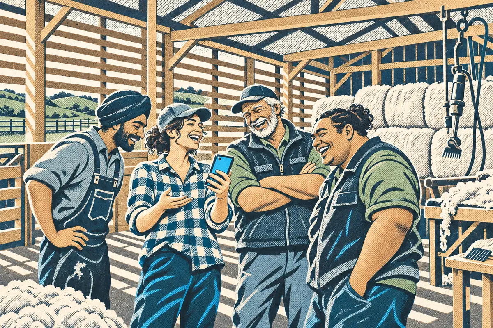

# Show and tell

You've asked AI about your farm with no data and with real data. The most useful thing you can do now is share what happened, especially what it got wrong.

> **On the farm:** The farmers in your district are asking the same tools the same questions. One screenshot of AI confidently getting your rain wrong teaches the room more than an hour of talk about it.

## What to share

Pick one and bring it to your district group chat or the next build night:

- **The two answers side by side:** what AI said with no data, and what it said with your rain card.
- **The biggest miss:** the number or claim it got most wrong without data, and how sure it sounded.
- **What it still can't know:** one thing about your farm's rain that no gauge or grid cell captures, like the paddock that always holds water.

## How to share it

- Take a screenshot of each answer, or copy the text.
- Post it in your district group with a line on what surprised you.
- At a build night, show it on your phone and say what you'd ask next.

> **Tip:** Crop out anything you don't want others to see. The rain card only holds public data about your address, but check before you share your address with a wider group.

This part is optional, but it's where a lot of the learning happens. Hearing that a neighbour's AI got their district wrong in a different way makes the lesson stick.

## Try it

Write the one line you'd post with your screenshots.

**Example:** "Asked AI about rain since July with no data: it said a bit dry. With the rain card: 137% of normal, so wetter than usual. Same app, same question."

## Before the quiz

You now know the three kinds of AI, where they already turn up on farms, what chat AI does well and badly, and how to hold a first conversation. You've also put your farm on the map, which every later module builds on.

Next up is the module quiz. You need 80% to pass, and you can retake it.
